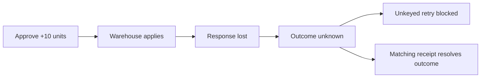
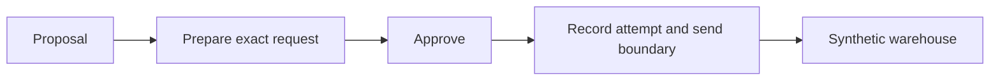

# Work Steward — Agent Engine

An inventory update can succeed even when your app sees a timeout. Retrying may update stock twice.

Agent Engine keeps the approved request, each attempt, and evidence of the result in a durable history. When a result is uncertain, it can block another send until repetition is justified. We are building this execution layer for AI-assisted business workflows.

**Experimental; synthetic data only.** The reference application uses CLI proposals and a separate warehouse process. No credentials or model API key are needed. Real connectors and model integration remain future work.

## Try it

On macOS or Linux, install [uv](https://docs.astral.sh/uv/getting-started/installation/), Git, and Make:

```sh
git clone https://github.com/work-steward/agent-engine.git
cd agent-engine
uv sync --frozen
make demo
```

The warehouse receives 10 `DEMO-WIDGET` units. Look for these fields in the JSON output; excerpts here omit IDs and other details:

```json
{
  "effect": "effect_confirmed",
  "attempts": 1,
  "stock": {"quantity": 10, "version": 1}
}
```

Python is pinned in [.python-version](.python-version); dependencies are locked in [uv.lock](uv.lock).

## A 60–90-second failure walkthrough

After installation, run a fresh case where the warehouse applies the receipt and drops its response. This case deliberately uses an unconditional adjustment and a provider with no idempotency key:

```sh
inventory_demo_dir=$(mktemp -d)
uv run --frozen python -m examples.inventory --directory "$inventory_demo_dir" run --scenario unsafe-retry
```

Relevant output:

```json
{
  "effect": "unknown",
  "attempts": 1,
  "checkpoints": ["unknown", "unsafe_retry_blocked"],
  "stock": {"quantity": 10, "version": 1}
}
```

The stock changed, but the engine did not receive a usable receipt. It refuses the requested retry and retains one attempt. A stock snapshot cannot identify which request changed it, so the operation stays `unknown` until matching evidence is admitted.



[Reconcile and inspect this case](examples/inventory/README.md#resolve-the-lost-response) without another adjustment. The [scenario guide](examples/inventory/README.md) also covers crashes, revoked approval, stale evidence, and a resumed old sender with permanent-key deduplication. Runs retain their databases; a fresh directory starts a fresh case.

## How it works



- **Current permission:** admission and release check scope, evidence, expiry, revocation, and approval of the exact request.
- **Durable state:** SQLite commits state and journal changes together. Restart cannot replay an old send boundary.
- **Evidence and recovery:** verified receipts resolve outcomes under separate read permission. Cancellation preserves effects that may already have happened. Uncertain repetition currently requires the declared permanent-key contract.

These guarantees assume a trusted host, surviving authoritative databases, and an honest synthetic provider. The [comparison and limitations](docs/comparison.md) explain the relationship to Temporal, Inngest, and application-side retries. No performance or safety superiority is claimed.

## Evaluate or contribute

Use the [external evaluation guide](docs/evaluation.md) to challenge specific claims, including schedules that would falsify them. Run `make check` for lint, fault tests, and the coverage gate; `make audit` checks current dependency advisories.

Start with the [scoped contributor issues](CONTRIBUTING.md#starting-points) for documentation, fault scenarios, protocol analysis, and tests. Each has a starting point and acceptance criteria.

The [architecture](docs/architecture.md), [conformance evidence](docs/conformance.md), and [roadmap](docs/ROADMAP.md) map implemented behavior and remaining work. See [design decisions](docs/decisions/README.md), [governance](GOVERNANCE.md), [security reporting](SECURITY.md), and [third-party notices](THIRD_PARTY_NOTICES.md).

Licensed under [Apache-2.0](LICENSE).
