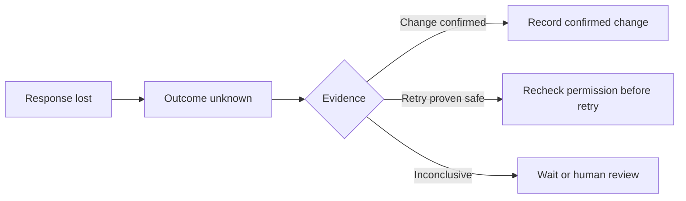

# Work Steward — Agent Engine

Work Steward is building a self-hostable execution engine for AI-assisted business workflows. Its goal is to keep business actions within approved limits, preserve their history across restarts, and make uncertain outcomes visible.

**Status: experimental.** Run the synthetic inventory workflow locally without credentials or a model API key. It uses CLI proposals and a separate warehouse simulator. Use synthetic data only; real integrations remain unsupported.

## Why this exists

An AI assistant can propose a sensible action and still execute it badly: use stale permission, submit the same change twice, or retry after a timeout even though the first request succeeded.

For example, an inventory system might apply a stock adjustment and lose the response. Retrying could adjust stock twice. Calling the first attempt “failed” would hide what actually matters: whether the stock changed.

Work Steward separates what was requested, what was allowed, what was attempted, and what is known about the result.

## How it works

The engine prepares an exact request for approval, checks current permission, and records each attempt before a single HTTP send:


- **Permissions:** approvals bind exact intent, request, and policy revision. Admission and release check current scope, evidence, expiry, and revocation.
- **Durable records:** SQLite commits state and journal changes together, rejects stale updates, and retains business-key reservations to detect repeated submissions.
- **Explicit uncertainty:** timeouts do not prove failure, and cancellation cannot undo an action that may already have reached another system.

After a lost response, the engine admits only evidence tied to the recorded request. Missing status leaves the outcome unknown:



## Current scope

| Area | Today |
| --- | --- |
| Engine | Durable state, exact request/approval bindings, fenced dispatch, and verified synthetic outcomes |
| Reference workflow | Inventory adjustments with an operator CLI and repeatable failure scenarios |
| Supported setup | Trusted macOS/Linux host, local SQLite, one organization and bound provider account per database |
| Later work | Real connectors, external caller authentication, model integration, and a nontechnical workbench |

The [architecture](docs/architecture.md) maps components to code and tests. The [roadmap](docs/ROADMAP.md) and [conformance gates](docs/conformance.md) describe the remaining work and required evidence.

## Get started

Install [uv](https://docs.astral.sh/uv/getting-started/installation/) and run:

```sh
uv sync --frozen
make demo
```

See the [inventory guide](examples/inventory/README.md) for scenarios and manual approvals. Run `make check` for lint, fault tests, and the coverage gate. Python is pinned in [.python-version](.python-version); dependencies are locked in [uv.lock](uv.lock).

## Project guides

- [Design decisions](docs/decisions/README.md)
- [Threat model](docs/threat-model.md)
- [Third-party licenses](THIRD_PARTY_NOTICES.md)
- [Contributing](CONTRIBUTING.md), [governance](GOVERNANCE.md), and [security reporting](SECURITY.md)

Licensed under [Apache-2.0](LICENSE).
