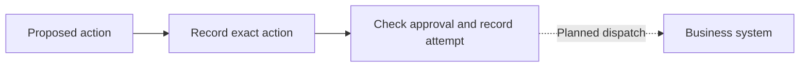
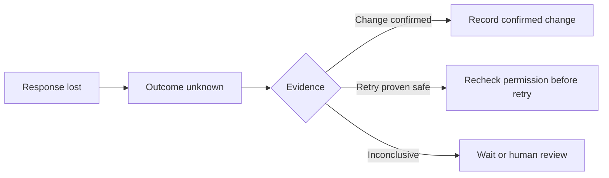

# Work Steward — Agent Engine

Work Steward is building a self-hostable execution engine for AI-assisted business workflows. Its goal is to keep business actions within approved limits, preserve their history across restarts, and make uncertain outcomes visible.

**Status: experimental.** Local engine components and synthetic tests are implemented. Production dispatch and real connectors are still planned. Use synthetic data only.

## Why this exists

An AI assistant can propose a sensible action and still execute it badly: use stale permission, submit the same change twice, or retry after a timeout even though the first request succeeded.

For example, an inventory system might apply a stock adjustment and lose the response. Retrying could adjust stock twice. Calling the first attempt “failed” would hide what actually matters: whether the stock changed.

Work Steward separates what was requested, what was allowed, what was attempted, and what is known about the result.

## How it works

The local engine records an exact action, checks permission, and persists an attempt. A planned dispatcher will connect it to business systems:



- **Permissions:** approvals bind an exact action and policy revision. Before an attempt, the engine checks current scope, evidence, expiry, and revocation.
- **Durable records:** SQLite commits state and journal changes together, rejects stale updates, and retains business-key reservations to detect repeated submissions.
- **Explicit uncertainty:** timeouts do not prove failure, and cancellation cannot undo an action that may already have reached another system.

The target recovery flow uses evidence from the business system. Evidence verification and reconciliation are still planned:



## Current scope

| Area | Today |
| --- | --- |
| Engine | Typed intents, action reference model, durable ledger and reservations, local policy and approvals |
| Test environment | Independent HTTP provider simulator; crash, response-loss, concurrency, and revocation cases |
| Supported setup | Trusted host, local SQLite, one organization per database |
| Remaining work | Caller authentication, request mapping and dispatch, provider-proof verification and reconciliation, real connectors, operator API/CLI |

The [architecture](docs/architecture.md) maps components to code and tests. The [roadmap](docs/ROADMAP.md) and [conformance gates](docs/conformance.md) describe the remaining work and required evidence.

## Get started

Install [uv](https://docs.astral.sh/uv/getting-started/installation/) and run:

```sh
uv sync --frozen
make check
```

Python is pinned in [.python-version](.python-version); dependencies are locked in [uv.lock](uv.lock). Checks include lint, fault tests, and a coverage gate. See [development](docs/DEVELOPMENT.md) for simulator and storage usage.

## Project guides

- [Design decisions](docs/decisions/README.md)
- [Threat model](docs/threat-model.md)
- [Contributing](CONTRIBUTING.md), [governance](GOVERNANCE.md), and [security reporting](SECURITY.md)

Licensed under [Apache-2.0](LICENSE).
